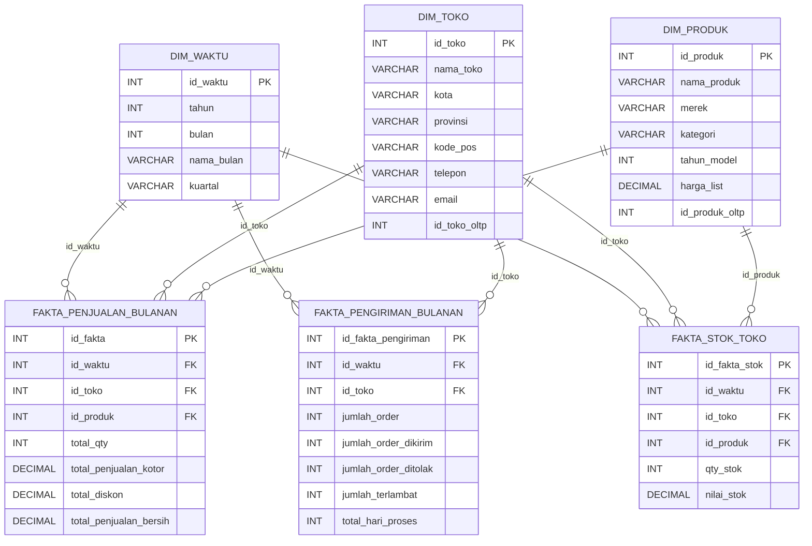

# Data Warehouse Bike Store

Tugas mata kuliah Data Warehouse: membangun data warehouse (star schema, 3 tabel fakta) dari database OLTP toko sepeda, lengkap dengan proses profiling dan cleansing data (data quality), ETL, dan query pengujian.

> **Nama**: [isi nama] &nbsp;|&nbsp; **NIM**: [isi NIM] &nbsp;|&nbsp; **Mata kuliah**: [isi mata kuliah / dosen]

Rancangan mengikuti materi buku acuan dosen: *Data Warehouse: Teori dan Praktek* (Sukarsa, Githa, Wisswani, 2026), terutama Bab 4 (ETL), Bab 5 (desain DWH), Bab 6 (denormalisasi), dan Bab 10 (data quality). Proyek ini dikerjakan dengan bantuan AI.

---

## Daftar isi

1. [Ringkasan](#1-ringkasan)
2. [Sumber data (OLTP)](#2-sumber-data-oltp)
3. [Proses bisnis](#3-proses-bisnis)
4. [Arsitektur dan alur data](#4-arsitektur-dan-alur-data)
5. [Desain data warehouse](#5-desain-data-warehouse)
6. [Data quality dan cleansing](#6-data-quality-dan-cleansing)
7. [Struktur repositori](#7-struktur-repositori)
8. [Cara menjalankan](#8-cara-menjalankan)
9. [Query pengujian](#9-query-pengujian)
10. [Asumsi dan keputusan desain](#10-asumsi-dan-keputusan-desain)
11. [Keterbatasan](#11-keterbatasan)
12. [Referensi](#12-referensi)

---

## 1. Ringkasan

| Ketentuan tugas | Pemenuhan |
|---|---|
| Kasus OLTP dari internet | Bike Store Sample Database (Kaggle) |
| Memahami proses bisnis | [Bagian 3](#3-proses-bisnis) |
| Minimal 3 tabel fakta | 3 fakta: penjualan, pengiriman, stok |
| Dimensi sederhana | 3 dimensi: waktu, produk, toko |
| Cleansing dan data quality | `cleansing_tools.py` (profiling, aturan DQ, log, reject) |
| Tools bebas | Python (pandas), MySQL |

Hasil akhir proyek:

- Skema DWH berbentuk fact constellation (3 star schema yang berbagi dimensi).
- Tool cleansing yang menghasilkan data bersih, log kualitas data, dan daftar baris yang ditolak.
- Skrip ETL yang memuat data bersih ke MySQL dan merekonsiliasi hasilnya dengan sumber.
- Query uji integritas dan query analitik untuk menjawab pertanyaan bisnis.

## 2. Sumber data (OLTP)

- Dataset: [Bike Store Sample Database (Kaggle, Dillon Myrick)](https://www.kaggle.com/datasets/dillonmyrick/bike-store-sample-database)
- Asal skema: [BikeStores sample database (sqlservertutorial.net)](https://www.sqlservertutorial.net/sql-server-sample-database/)

Dataset terdiri dari 9 tabel CSV:

| Tabel | Isi | Relasi (foreign key) |
|---|---|---|
| `stores` | Data toko | - |
| `staffs` | Staf toko | `store_id`, `manager_id` |
| `customers` | Pelanggan | - |
| `brands` | Merek sepeda | - |
| `categories` | Kategori sepeda | - |
| `products` | Produk | `brand_id`, `category_id` |
| `orders` | Header order | `customer_id`, `store_id`, `staff_id` |
| `order_items` | Baris isi order | `order_id`, `product_id` |
| `stocks` | Stok produk per toko | `store_id`, `product_id` |

Dataset tidak disertakan di repositori ini. Unduh sendiri dari Kaggle lalu ekstrak ke folder `archive/` (lihat [Cara menjalankan](#8-cara-menjalankan)).

## 3. Proses bisnis

Bike Store adalah ritel sepeda dengan beberapa toko cabang.

1. Pelanggan membeli sepeda di sebuah toko. Staf toko membuat order (tabel `orders`) berisi pelanggan, toko, staf, tanggal order, dan tanggal yang dijanjikan (`required_date`).
2. Isi order dicatat per baris (`order_items`): produk, jumlah, harga list saat transaksi, dan diskon.
3. Order bergerak melalui status: 1 Pending, 2 Processing, 3 Rejected, 4 Completed. Order Completed memiliki `shipped_date`.
4. Stok setiap produk di setiap toko dicatat di `stocks`.

Pertanyaan bisnis yang dijawab oleh DWH:

- **Penjualan**: kategori dan merek apa yang paling laku? Toko mana yang omzetnya tertinggi? Bagaimana tren bulanan dan kuartalan? Seberapa besar diskon menggerus omzet?
- **Pengiriman**: berapa persen order terlambat dikirim per toko? Berapa rata-rata lama proses? Berapa order yang ditolak?
- **Stok**: berapa nilai persediaan per toko? Produk apa yang laku tetapi stoknya tipis?

## 4. Arsitektur dan alur data

```text
 CSV OLTP (archive/)
        |
        v
 [1] cleansing_tools.py   load ke staging -> profiling -> aturan DQ -> cleansing
        |                  -> output/cleaned/*.csv, dq_log.csv, dq_reject.csv
        v
 [2] 01_setup_dwh.sql      membuat database dw_bikestores (dimensi, fakta, dim_waktu)
        |
        v
 [3] etl_dwh.py            transform + load dimensi dan fakta -> rekonsiliasi
        |
        v
 [4] 02_query_test.sql     uji integritas + query analitik
```

Pembersihan data dilakukan di tahap staging, sebelum data masuk ke DWH (Bab 10.6.3 buku acuan).

## 5. Desain data warehouse

### 5.1 Bus matrix

| Tabel fakta | `dim_waktu` | `dim_produk` | `dim_toko` |
|---|:-:|:-:|:-:|
| `fakta_penjualan_bulanan` | ✓ | ✓ | ✓ |
| `fakta_pengiriman_bulanan` | ✓ | - | ✓ |
| `fakta_stok_toko` | ✓ | ✓ | ✓ |

Ketiga fakta memakai dimensi yang sama (conformed dimension), sehingga hasilnya bisa dibandingkan lintas fakta.

### 5.2 Diagram skema



### 5.3 Tabel dimensi

| Dimensi | Isi | Catatan |
|---|---|---|
| `dim_waktu` | `id_waktu` (YYYYMM), tahun, bulan, nama bulan, kuartal | Dibangkitkan Januari 2016 sampai Desember 2027 (144 baris) |
| `dim_produk` | nama produk, merek, kategori, tahun model, harga list, `id_produk_oltp` | Gabungan `products` + `brands` + `categories` (denormalisasi, Bab 6) |
| `dim_toko` | nama toko, kota, provinsi, kode pos, telepon, email, `id_toko_oltp` | Dari `stores` |

Kolom `id_*_oltp` menyimpan ID asli di sumber (lineage) dan menjadi kunci upsert saat ETL.

### 5.4 Tabel fakta

| Fakta | Grain | Ukuran (measure) |
|---|---|---|
| `fakta_penjualan_bulanan` | 1 produk x 1 toko x 1 bulan order | `total_qty`, `total_penjualan_kotor`, `total_diskon`, `total_penjualan_bersih` |
| `fakta_pengiriman_bulanan` | 1 toko x 1 bulan order | `jumlah_order`, `jumlah_order_dikirim`, `jumlah_order_ditolak`, `jumlah_terlambat`, `total_hari_proses` |
| `fakta_stok_toko` | 1 produk x 1 toko x 1 bulan snapshot (periodic snapshot) | `qty_stok`, `nilai_stok` (semi-aditif) |

Persentase keterlambatan tidak disimpan di tabel karena rasio tidak bisa dijumlahkan. Nilainya dihitung saat query: `jumlah_terlambat / jumlah_order_dikirim`.

## 6. Data quality dan cleansing

`cleansing_tools.py` menjalankan alur berikut:

1. Load 9 CSV apa adanya (semua kolom dibaca sebagai teks agar masalah tipe data terdeteksi, token `NULL` dianggap kosong).
2. Profiling kolom sebelum cleansing: jumlah baris, jumlah dan persen NULL, jumlah nilai unik, nilai min dan max.
3. Menjalankan aturan data quality per tabel, mengikuti karakteristik pada Bab 10 buku acuan.
4. Membersihkan data di staging (urutan tabel mengikuti dependensi foreign key).
5. Baris yang melanggar aturan masuk ke `dq_reject.csv` beserta alasannya, tidak dihapus diam-diam.
6. Profiling ulang setelah cleansing dan menyimpan log lengkap.

Ringkasan aturan:

| Karakteristik | Contoh aturan |
|---|---|
| Completeness | Kolom wajib terisi; persentase NULL pada kolom opsional |
| Domain integrity | `order_status` 1 sampai 4; `discount` 0 sampai 1; `quantity` dan `list_price` lebih dari 0; `model_year` wajar |
| Data type | Angka dan tanggal harus valid; `zip_code` disimpan sebagai teks |
| Business rule | `required_date` dan `shipped_date` tidak boleh sebelum `order_date`; order Completed wajib punya `shipped_date` |
| Integritas referensial | `order_items` harus punya order dan produk induk yang valid; `stocks` harus punya toko dan produk valid |
| Duplication | Duplikat kunci utama dibuang; kemungkinan pelanggan ganda hanya ditandai |
| Consistency | Trim spasi, standarisasi huruf besar-kecil (nama, kota, state, email), kota yang muncul di lebih dari satu state ditandai |
| Data anomaly | Outlier harga dan jumlah (aturan IQR) hanya ditandai |

Prioritas pembersihan mengikuti Bab 10.6.5: elemen yang memengaruhi analisis (jumlah, harga, diskon, status order, foreign key) berprioritas tinggi dan harus bersih; kontak pelanggan berprioritas rendah. Aturan bertanda "Hanya ditandai" tidak membuang baris, hanya dicatat di log untuk ditinjau manual.

### Hasil cleansing

Isi tabel berikut setelah menjalankan `cleansing_tools.py` pada data asli (sumber: `output/ringkasan_baris.csv`).

| Tabel | Baris sebelum | Baris sesudah | Baris ditolak |
|---|---:|---:|---:|
| brands | | | |
| categories | | | |
| customers | | | |
| order_items | | | |
| orders | | | |
| products | | | |
| staffs | | | |
| stocks | | | |
| stores | | | |

Temuan per aturan ada di `output/dq_log.csv`.

## 7. Struktur repositori

```text
.
├── archive/                  # 9 CSV dataset Kaggle (diunduh sendiri, tidak di-commit)
├── output/                   # dibuat otomatis oleh cleansing_tools.py
│   ├── cleaned/              # CSV bersih, masukan untuk ETL
│   ├── dq_log.csv            # log tiap aturan data quality
│   ├── dq_reject.csv         # baris yang ditolak beserta alasannya
│   ├── profil_sebelum.csv
│   ├── profil_sesudah.csv
│   └── ringkasan_baris.csv
├── cleansing_tools.py        # profiling + cleansing data
├── 01_setup_dwh.sql          # membuat database dan tabel DWH
├── etl_dwh.py                # ETL: CSV bersih -> MySQL
├── 02_query_test.sql         # uji integritas + query analitik
└── README.md
```

Disarankan menambahkan `.gitignore` berikut agar dataset dan hasil olahan tidak ikut ter-commit:

```text
archive/
output/
__pycache__/
```

## 8. Cara menjalankan

### Prasyarat

- Python 3.9 atau lebih baru
- MySQL 8.0.16 atau lebih baru (skrip memakai `WITH RECURSIVE`, `CHECK`, dan window function)
- Library Python: `pandas` dan `mysql-connector-python`

```bash
pip install pandas mysql-connector-python
```

### Langkah

1. **Siapkan dataset.** Unduh dari [Kaggle](https://www.kaggle.com/datasets/dillonmyrick/bike-store-sample-database), ekstrak ke folder `archive/` sehingga terdapat `archive/orders.csv`, `archive/products.csv`, dan seterusnya.

2. **Jalankan cleansing.**

   ```bash
   python cleansing_tools.py
   ```

   Hasil ada di folder `output/`. Periksa `dq_log.csv` dan `dq_reject.csv`.

3. **Buat database DWH.** Jalankan `01_setup_dwh.sql` di MySQL Workbench, DBeaver, atau lewat terminal:

   ```bash
   mysql -u root -p < 01_setup_dwh.sql
   ```

   Skrip ini membuat database `dw_bikestores`, semua tabel, dan mengisi `dim_waktu`. Aman dijalankan ulang karena tabel lama di-drop terlebih dahulu.

4. **Atur koneksi database.** Buka `etl_dwh.py`, isi `DB_CONFIG` (host, port, user, password).

5. **(Opsional) Uji transformasi tanpa database.**

   ```bash
   python etl_dwh.py --dry-run
   ```

6. **Jalankan ETL.**

   ```bash
   python etl_dwh.py
   ```

   Di akhir proses ada rekonsiliasi otomatis yang membandingkan total qty, omzet bersih, jumlah order, dan stok antara CSV sumber dengan isi DWH. Hasilnya `PASS` atau `FAIL` per pemeriksaan.

7. **Jalankan query pengujian** dari `02_query_test.sql`.

### Strategi load ETL

| Tabel | Strategi |
|---|---|
| `dim_toko`, `dim_produk` | Upsert berdasarkan ID OLTP, sehingga surrogate key stabil saat ETL diulang |
| `fakta_penjualan_bulanan`, `fakta_pengiriman_bulanan` | Dikosongkan lalu dimuat ulang (selalu bisa dibangun ulang dari sumber) |
| `fakta_stok_toko` | Snapshot bulan berjalan dihapus lalu dimuat ulang; snapshot bulan sebelumnya dipertahankan sebagai riwayat |

## 9. Query pengujian

`02_query_test.sql` terdiri dari tiga bagian:

- **A. Sanity check**: semua tabel terisi, rentang waktu data.
- **B. Uji integritas** (harapan: semua mengembalikan 0 baris): duplikasi pada grain, foreign key yatim, konsistensi `bersih = kotor - diskon`, logika komponen pengiriman, nilai stok.
- **C. Query analitik**:

| Kode | Pertanyaan bisnis |
|---|---|
| C1 | Tren omzet bersih bulanan |
| C2 | Omzet per toko per tahun beserta porsinya |
| C3 | Omzet per kuartal |
| C4 | 10 produk terlaris |
| C5 | Omzet per kategori dan per merek |
| C6 | Persentase diskon per kategori |
| C7 | Pertumbuhan omzet bulan ke bulan |
| C8 | Kinerja pengiriman per toko per tahun (persen terlambat, rata-rata hari proses) |
| C9 | Bulan dengan keterlambatan tertinggi |
| C10 | Nilai persediaan per toko |
| C11 | Stok per kategori per toko |
| C12 | Produk laris tetapi stok tipis (lintas fakta) |
| C13 | Ringkasan per toko dari ketiga fakta |

## 10. Asumsi dan keputusan desain

- **Definisi penjualan**: hanya order berstatus Completed (4) yang dihitung sebagai omzet. Order Pending, Processing, dan Rejected tetap dihitung di fakta pengiriman.
- **Nilai bersih** = `quantity x list_price x (1 - discount)`, memakai harga di `order_items` (harga saat transaksi), bukan harga terkini di `products`.
- **Grain bulanan** ditentukan dari `order_date`, mengikuti contoh pada buku acuan.
- **Stok** pada dataset tidak memiliki tanggal, sehingga hanya berupa potret kondisi saat ini. Bulan snapshot diisi dengan bulan saat ETL dijalankan; riwayat stok baru terbentuk jika ETL dijalankan rutin tiap bulan.
- **Staf dan pelanggan** tidak dijadikan dimensi agar rancangan tetap sederhana. Keduanya dapat ditambahkan sebagai `dim_staf` dan `dim_pelanggan` pada pengembangan berikutnya.
- **Dimensi bertipe SCD Tipe 1** (atribut ditimpa saat berubah); riwayat perubahan atribut tidak disimpan.

## 11. Keterbatasan

- Struktur kolom dan arti kode status order bersumber dari dokumentasi publik BikeStores. Periksa ulang terhadap CSV yang diunduh, karena nama kolom bisa sedikit berbeda.
- Skrip cleansing dan transformasi ETL diuji dengan data tiruan berstruktur sama (dengan error yang sengaja disisipkan) menggunakan pandas 3.0.2. Penulisan ke MySQL dan kedua file SQL belum diuji pada server MySQL nyata oleh penyusun skrip; jika ada error, laporkan lewat Issues.
- Aturan data quality berprioritas tinggi bisa menolak banyak baris jika asumsi domain (misalnya kode status 1 sampai 4) tidak sesuai data. Konfigurasi aturan ada di bagian atas `cleansing_tools.py`.

## 12. Referensi

- Sukarsa, I. M., Githa, D. P., Wisswani, N. W. (2026). *Data Warehouse: Teori dan Praktek.*
- Bike Store Sample Database di Kaggle: https://www.kaggle.com/datasets/dillonmyrick/bike-store-sample-database
- BikeStores sample database: https://www.sqlservertutorial.net/sql-server-sample-database/
